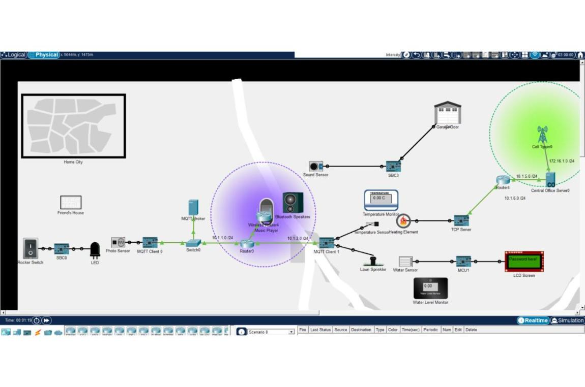
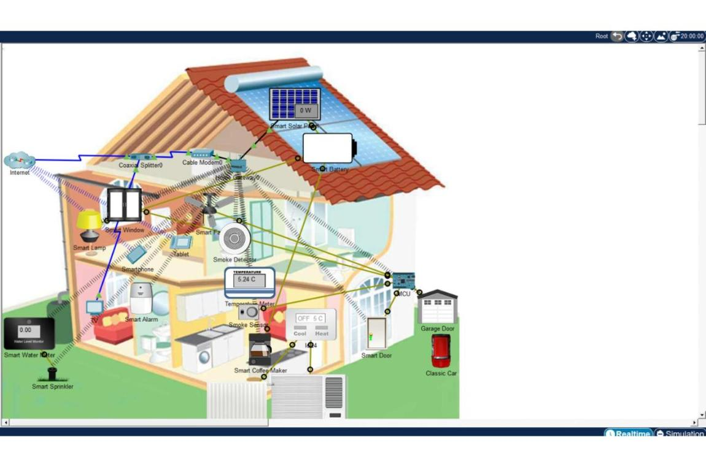

# Secure smart home with Cisco Packet Tracer

Network and IoT project I did for my cybersecurity bachelor at EPHEC. I designed a full home automation architecture that simulates a realistic IoT ecosystem: sensors, actuators, machine to machine communication and Wi-Fi access control.

The network is segmented in several subnets, with routers, a switch and a wireless access point. The sensors and the clients talk to each other with MQTT (publish/subscribe).

The scenario is an automated chain of events: light detection, sound activation, garage door opening, vehicle detection, heating activation through a TCP server, a sprinkler that only starts under some conditions, and at the end the display of a secure password. The access point uses WPA2 and the access is only possible once the scenario is completed. Several sensors (temperature thresholds, water level) drive the actuators with conditional logic.

What I worked on: network design and configuration on Cisco, Wi-Fi security with WPA2, IoT protocols and machine to machine data flows, the attack surface of a connected ecosystem, and troubleshooting convergence problems.

Tools used: Cisco Packet Tracer, MQTT, WPA2.

