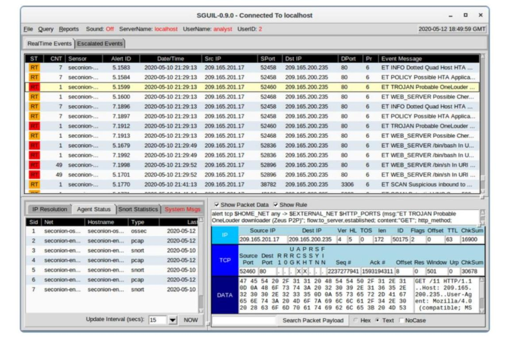

# Sguil and Security Onion: digging into a Snort alert

An alert on a dashboard means very little until you dig into the raw packets. In this Cisco CyberOps lab the goal was to go further than the alert and do a precise technical investigation with Sguil and Security Onion.

By correlating the Snort detections, the attack path becomes clear. An internal host (209.165.201.17) triggers an alert for a Trojan downloader (Zeus P2P / OneLouder), then there are suspicious HTTP requests trying to run /bin/bash and /bin/sh, and after that some inbound port scanning.

The real analyst work happens in the packet inspection window. I read the Snort signature to rule out false positives, checked the raw payload in hex and ASCII to look at the HTTP request headers and the User-Agent, and rebuilt the full timeline of the attack to see how big the incident was.

Checking the raw network evidence before drawing a conclusion is the mindset I want to keep for a SOC or blue team role.

Tools used: Sguil, Security Onion, Snort.

