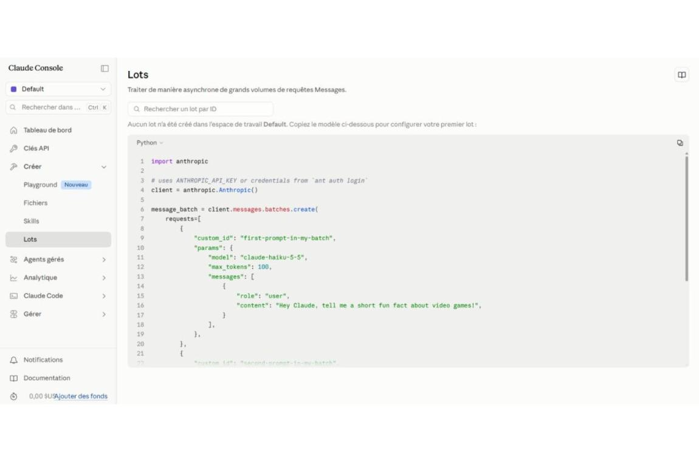

# Controlling token usage with the Claude API (Python)

I explored the Claude Console and the Claude API to understand how to control the length of the responses, and so the token consumption and the cost of the API calls.

First I created an API key in the Claude Console (API Keys section) to authenticate my requests. The official Python SDK reads it from the ANTHROPIC_API_KEY environment variable, so the key never appears in the code.

Then I installed the official Python SDK with pip install anthropic.

Then I opened the Message Batches page of the Console, which gives a ready-to-use Python template to process many requests asynchronously.

In that template I found the max_tokens parameter, set to 100, which caps the number of tokens Claude can generate in each response. I replaced it with my own value: a low limit for short and cheap answers, a higher one for longer outputs. The maximum allowed depends on the model chosen in the model field.

What I take from it: the API key authenticates, while max_tokens and the choice of model define the token budget of each request. Together with the usage monitoring in the Console, it is a simple way to keep AI costs under control.

Tools used: Python, Claude API (Anthropic), Claude Console, Message Batches.

